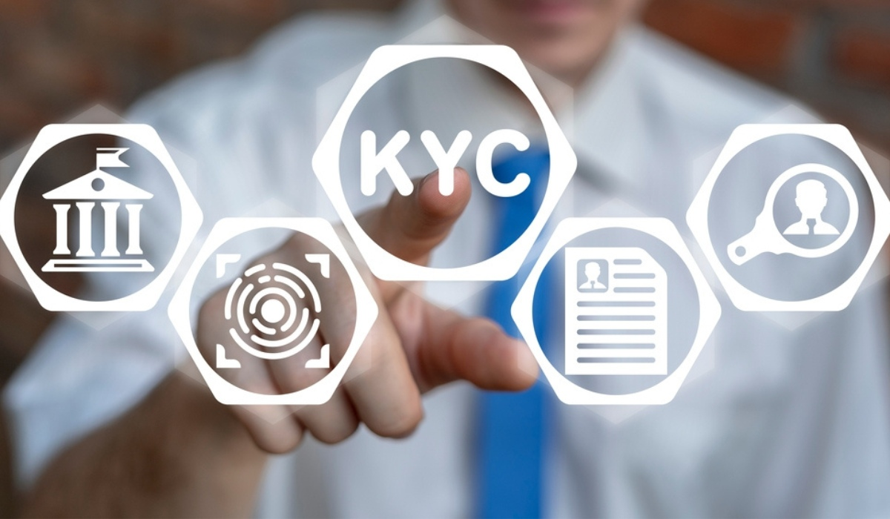

# Privacy-Preserving Blockchain-Based e-KYC Framework

A secure and privacy-focused Electronic Know Your Customer (e-KYC) framework designed to support digital identity verification, identity document management, and controlled access to KYC information.

## 📌 Project Overview

The **Privacy-Preserving Blockchain-Based e-KYC Framework** aims to improve the security, transparency, and privacy of digital identity verification. It provides separate modules for users, owners, authorities, and servers to support identity registration, authentication, KYC document uploads, and permission-based access.

The project explores the use of blockchain-based concepts to improve trust and accountability in electronic identity verification.

## 🎯 Objectives

- Simplify the electronic KYC verification process.
- Protect sensitive identity information from unauthorized access.
- Provide role-based login and authentication.
- Support secure KYC document uploads and access permissions.
- Improve transparency and trust in digital identity management.

## ✨ Key Features

- **User Registration and Login:** Allows users to register and access their accounts.
- **Owner Module:** Supports owner-related registration and KYC management operations.
- **Authority Module:** Provides interfaces for authority authentication and user or owner management.
- **KYC Document Management:** Supports uploading and managing electronic KYC information.
- **Permission Management:** Includes user-facing functionality for requesting or managing e-KYC access permissions.
- **Authentication:** Provides separate login and authentication pages for different roles.
- **Database Integration:** Includes an SQL database script for database setup.
- **Web Interface:** Uses JSP pages and HTML to provide a browser-based interface.

## 🛠️ Technologies Used

| Technology | Purpose |
|---|---|
| Java | Application logic |
| JSP (JavaServer Pages) | Dynamic web pages |
| HTML | Web page structure |
| MySQL | Database management |
| Apache Tomcat | Java web application server |
| SQL | Database creation and queries |

**Note:** Blockchain implementation details and additional security technologies should be documented according to the components actually implemented in the source code.

## 👥 System Modules

1. **User Module** – User registration, login, profile management, and e-KYC permission-related operations.
2. **Owner Module** – Owner authentication, registration, profile management, and e-KYC upload functionality.
3. **Authority Module** – Authority authentication and interfaces for managing user and owner information.
4. **Server Module** – Server authentication and access to server-related operations.
5. **Database Module** – Stores application information required by the system.

## 📂 Project Structure

```text
Privacy-Preserving-Blockchain-Based-e-KYC-Framework/
│
├── README.md
├── Database.sql
├── index.html
├── connect.jsp
│
├── user_login.jsp
├── u_register.jsp
├── u_main.jsp
├── u_profile.jsp
├── u_Permit_eKYC.jsp
│
├── owner_login.jsp
├── ow_register.jsp
├── ow_main.jsp
├── ow_profile.jsp
├── ow_upload_ekyc.jsp
│
├── au_login.jsp
├── au_main.jsp
├── au_profiles.jsp
│
├── bs_login.jsp
├── bs_main.jsp
│
└── Images and other JSP files
```

*This is a representative structure. The repository also contains additional JSP pages, images, and supporting files.*

## ⚙️ Installation and Setup

### Prerequisites

Install the following software:

- Java Development Kit (JDK)
- Apache Tomcat
- MySQL Server
- A Java-compatible IDE, such as Eclipse
- Git

### Step 1: Clone the Repository

```bash
git clone https://github.com/Arya-gunji/Privacy-Preserving-Blockchain-Based-e-KYC-Framework.git
```

### Step 2: Open the Project

Open the cloned project in your Java IDE and configure the required Java and Tomcat environment.

### Step 3: Configure the Database

1. Start MySQL Server.
2. Open MySQL Workbench or another MySQL client.
3. Locate `Database.sql` in the project directory.
4. Review and execute the SQL script to create the required database objects.
5. Check `connect.jsp` and configure the database URL, username, password, and driver according to your environment.

**Security:** Do not commit real database passwords or other credentials to GitHub.

### Step 4: Configure Apache Tomcat

Configure the Tomcat server in your IDE and deploy the application using the project’s supported deployment method.

### Step 5: Run the Application

Start the Tomcat server and open the application in your browser using the appropriate local URL, for example:

```text
http://localhost:8080/<application-context>/
```

Replace `<application-context>` with the actual deployed application context. The exact setup may vary depending on the original project configuration.

## 🔐 Privacy and Security Considerations

The project focuses on privacy-aware identity verification and controlled access to e-KYC information.

For a production deployment, the following protections should be verified or implemented:

- Secure password storage and authentication.
- Server-side authorization for every protected operation.
- Encryption of sensitive identity documents.
- Restricted access to KYC information.
- Secure database credential management.
- Audit logging and appropriate data-retention policies.

These are recommended security practices; their presence in the current implementation should be verified separately.

## 🖼️ Screenshots

## 🖼️ Project Screenshots

### 1. Login Page


### 2. Registration Page


### 3. User Dashboard


### 4. Owner Dashboard


### 5. Admin Login

```

Replace the example filenames with the actual screenshot filenames after adding them to the repository.

## 🚀 Future Enhancements

- Integrate and document a verified blockchain network and smart contracts.
- Add stronger encryption and secure key management.
- Introduce decentralized identifiers and verifiable credentials where appropriate.
- Improve access auditing and consent management.
- Add automated testing and deployment workflows.
- Modernize the user interface and improve accessibility.

## 🎓 Project Information

**Project Title:** Privacy-Preserving Blockchain-Based e-KYC Framework

**Author:** Arya Gunji

**GitHub Repository:** [Privacy-Preserving-Blockchain-Based-e-KYC-Framework](https://github.com/Arya-gunji/Privacy-Preserving-Blockchain-Based-e-KYC-Framework)

## 📄 License

No license has been specified yet. Add an appropriate open-source license if you intend to permit others to reuse, modify, or distribute this project.

---

If you find this project useful for learning about Java web applications and electronic identity verification, feel free to explore the repository.

## 🏗️ System Architecture

The e-KYC framework organizes identity verification through separate application modules and database connectivity.

```text
             Users / Owners
                    |
                    v
          Web Application (JSP)
                    |
                    v
          Authentication Modules
                    |
                    v
           e-KYC Management
                    |
                    v
           Database (MySQL)
```

## 🔄 Project Workflow

1. **Registration:** Users or owners register through the web application.
2. **Authentication:** Registered users log in through their respective modules.
3. **KYC Upload:** Owners can upload e-KYC information through the available interface.
4. **Access Permissions:** The application provides functionality related to e-KYC access permissions.
5. **Data Management:** Application information is handled through the database connection.
6. **Verification:** Authorized operations can be performed through the relevant application modules.

## 💡 Challenges and Solutions

### Challenges
- Managing sensitive KYC information securely.
- Organizing separate access modules for users, owners, and authorities.
- Connecting the Java web application to the database.
- Providing a simple interface for identity-related operations.

### Solutions
- Designed separate authentication pages for different roles.
- Used JSP pages to organize web application functionality.
- Included an SQL script for database setup.
- Structured the application into modules for easier maintenance.

*These points describe project design considerations; verify each implementation detail against the source code before presenting it as a completed solution.*

## 🧪 Testing

The following areas can be tested to validate the application:

- User and owner registration.
- Login and authentication.
- Database connectivity.
- e-KYC document upload.
- Access permission workflows.
- Validation of user inputs and error handling.

## 📚 Learning Outcomes

- Understanding Java web application development.
- Working with JSP and HTML.
- Connecting a web application to MySQL.
- Organizing role-based application modules.
- Understanding privacy and security considerations in digital identity systems.

## 👨‍💻 Author

**Arya Gunji**

- GitHub: [Arya-gunji](https://github.com/Arya-gunji)
- Project: [Privacy-Preserving Blockchain-Based e-KYC Framework](https://github.com/Arya-gunji/Privacy-Preserving-Blockchain-Based-e-KYC-Framework)
> Note: This diagram represents the high-level web application workflow. Add blockchain components to the architecture only after confirming their implementation in the source code.
